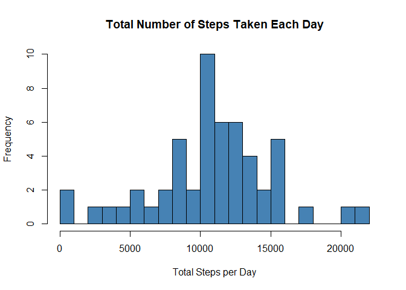
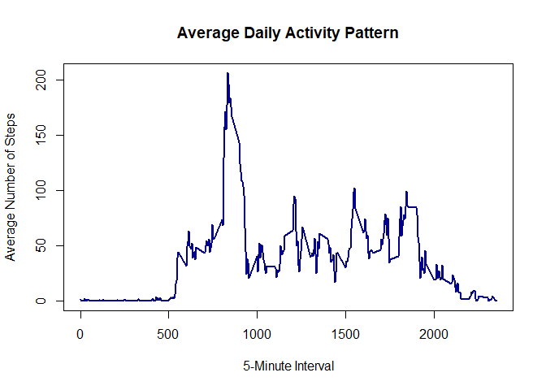
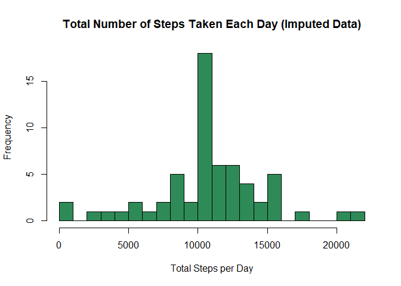
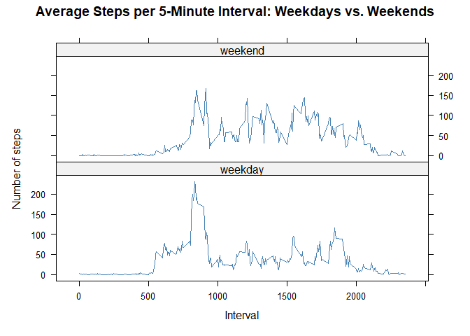

``` r
knitr::opts_chunk$set(echo = TRUE, fig.path = "figure/")
```

## Loading and preprocessing the data

First, we unzip the dataset if `activity.csv` is not already extracted in the working directory, load the data using `read.csv()`, and convert the `date` column into proper `Date` objects.


``` r
if (!file.exists("activity.csv")) {
    unzip("activity.zip")
}

activity <- read.csv("activity.csv", stringsAsFactors = FALSE)
activity$date <- as.Date(activity$date, format = "%Y-%m-%d")
str(activity)
```

```
## 'data.frame':	17568 obs. of  3 variables:
##  $ steps   : int  NA NA NA NA NA NA NA NA NA NA ...
##  $ date    : Date, format: "2012-10-01" ...
##  $ interval: int  0 5 10 15 20 25 30 35 40 45 ...
```

## What is mean total number of steps taken per day?

Ignoring missing values (`NA`), we aggregate the total number of steps taken each day, plot a histogram, and compute the mean and median.


``` r
total_steps_day <- aggregate(steps ~ date, data = activity, FUN = sum, na.rm = TRUE)

hist(total_steps_day$steps,
     main = "Total Number of Steps Taken Each Day",
     xlab = "Total Steps per Day",
     col = "steelblue",
     breaks = 20)
```

<!-- -->

``` r
mean_steps <- mean(total_steps_day$steps)
median_steps <- median(total_steps_day$steps)

mean_steps
```

```
## [1] 10766.19
```

``` r
median_steps
```

```
## [1] 10765
```

- **Mean total number of steps per day:** 10766.19
- **Median total number of steps per day:** 10765

## What is the average daily activity pattern?

Next, we calculate the average number of steps taken in each 5-minute interval across all days and identify the interval with the highest average activity.


``` r
avg_steps_interval <- aggregate(steps ~ interval, data = activity, FUN = mean, na.rm = TRUE)

plot(avg_steps_interval$interval,
     avg_steps_interval$steps,
     type = "l",
     col = "darkblue",
     lwd = 2,
     main = "Average Daily Activity Pattern",
     xlab = "5-Minute Interval",
     ylab = "Average Number of Steps")
```

<!-- -->

``` r
max_row <- avg_steps_interval[which.max(avg_steps_interval$steps), ]
max_row
```

```
##     interval    steps
## 104      835 206.1698
```

- **5-minute interval with maximum average steps:** Interval **835** (with an average of **206.17** steps).

## Imputing missing values

1. **Total number of missing values:** We count the rows with `NA` in the `steps` column.
2. **Imputation strategy:** Missing values are replaced with the mean number of steps for that corresponding 5-minute interval across all available days.


``` r
total_na <- sum(is.na(activity$steps))
total_na
```

```
## [1] 2304
```

``` r
# Merge interval averages and replace NAs
activity_imputed <- merge(activity, avg_steps_interval, by = "interval", suffixes = c("", "_avg"))
na_indices <- is.na(activity_imputed$steps)
activity_imputed$steps[na_indices] <- activity_imputed$steps_avg[na_indices]
activity_imputed <- activity_imputed[, c("steps", "date", "interval")]
activity_imputed <- activity_imputed[order(activity_imputed$date, activity_imputed$interval), ]

# Total steps per day after imputation
total_steps_day_imp <- aggregate(steps ~ date, data = activity_imputed, FUN = sum)

hist(total_steps_day_imp$steps,
     main = "Total Number of Steps Taken Each Day (Imputed Data)",
     xlab = "Total Steps per Day",
     col = "seagreen",
     breaks = 20)
```

<!-- -->

``` r
mean_steps_imp <- mean(total_steps_day_imp$steps)
median_steps_imp <- median(total_steps_day_imp$steps)

mean_steps_imp
```

```
## [1] 10766.19
```

``` r
median_steps_imp
```

```
## [1] 10766.19
```

- **Total rows with missing values:** 2304
- **Mean total steps per day (imputed):** 10766.19
- **Median total steps per day (imputed):** 10766.19
- **Comparison and impact:** The mean remains identical (`10766.19`) because missing days were filled using interval averages, while the median shifts slightly upward from `10765` to `10766.19` (matching the mean). Imputing missing values increases the frequency of days concentrated around the center/mean of the distribution without skewing the overall daily average.

## Are there differences in activity patterns between weekdays and weekends?

Using the imputed dataset and the `weekdays()` function, we classify each date into `"weekday"` or `"weekend"` and create a panel time series plot comparing average steps per 5-minute interval.


``` r
library(lattice)

day_names <- weekdays(activity_imputed$date)
activity_imputed$day_type <- ifelse(day_names %in% c("Saturday", "Sunday", "sábado", "domingo"),
                                    "weekend",
                                    "weekday")
activity_imputed$day_type <- factor(activity_imputed$day_type, levels = c("weekday", "weekend"))

avg_steps_daytype <- aggregate(steps ~ interval + day_type, data = activity_imputed, FUN = mean)

xyplot(steps ~ interval | day_type,
       data = avg_steps_daytype,
       type = "l",
       layout = c(1, 2),
       col = "steelblue",
       lwd = 1.5,
       main = "Average Steps per 5-Minute Interval: Weekdays vs. Weekends",
       xlab = "Interval",
       ylab = "Number of steps")
```

<!-- -->
